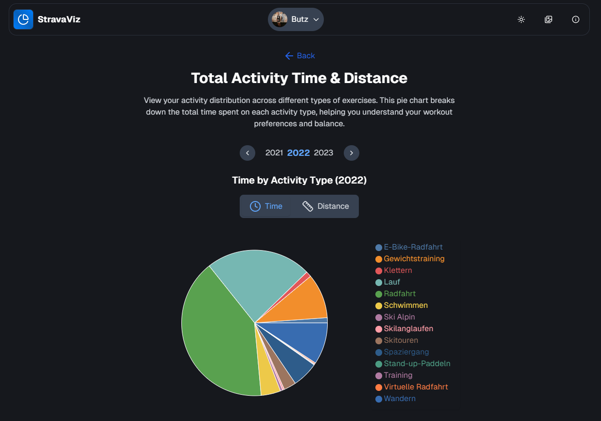

**StravaViz - An Interactive Data Visualization Tool**

This project was created for the practical project of the course “Information Visualization” (Winter term 2024/25) at LMU Munich, by Prof. Andreas Butz. Course page: https://www.medien.ifi.lmu.de/lehre/ws2425/iv/

**Live Demo**
- Explore the project at https://stravaviz.yuemya.de

**What it is**
- A student project that explores how personal fitness data from Strava can be visualized to tell meaningful stories about activity habits, progress, and routes.
- It takes a standard Strava data export and presents it through several easy-to-browse views.
- In this case we took the data export from Prof. Butz and one of our Team members.

**What you can see**
- Interactive map showing activity routes.
- Calendars and timelines for daily and monthly activity patterns.
- Simple performance summaries: distance, time, elevation, and calories over time.
- Heart rate vs. pace views to get an intuition for training intensity and efficiency.
- Bonus: A small gallery of images by Prof. Butz related to his activities.

**How to explore**
- Open the page, pick an athlete, and switch between views like “Map”, “Calendar”, “Performance”, and “Heart–Speed”.

**Acknowledgements**
- Thanks to [@moreichelt](https://github.com/moreichelt) and Prof. Butz for providing their fitness data.
